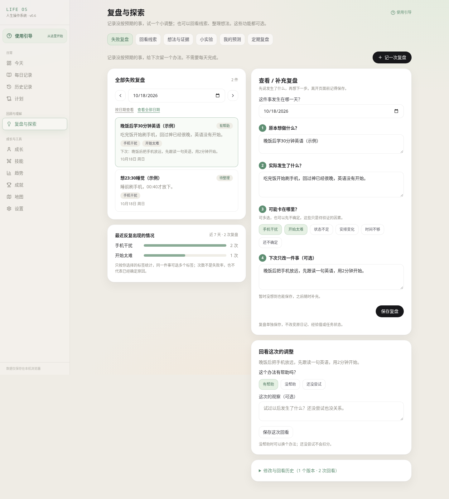
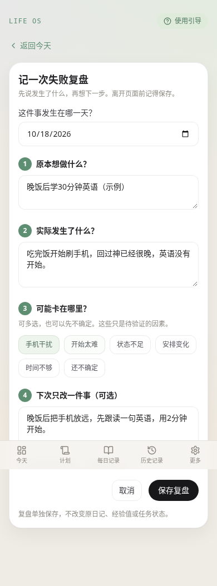
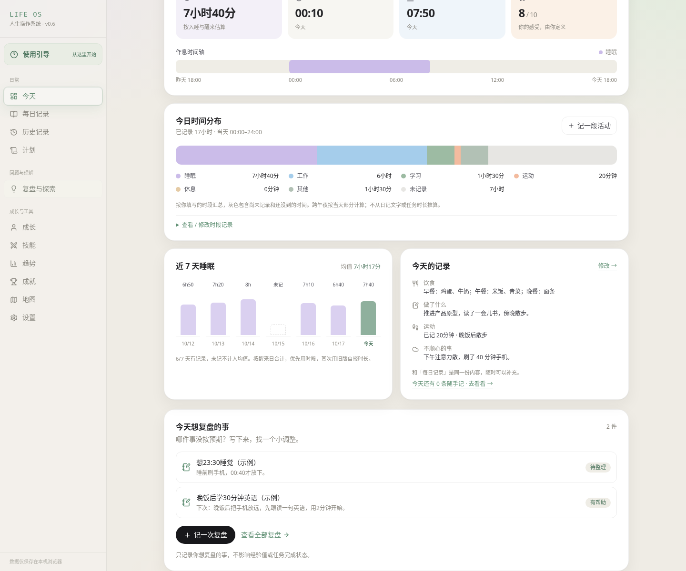
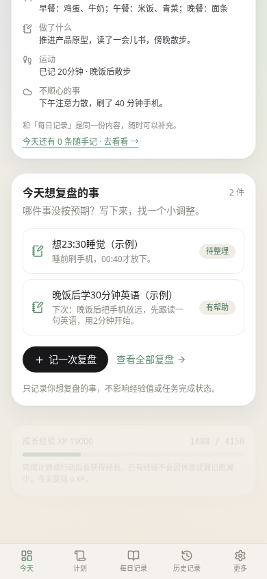

# 失败复盘：使用与兼容性

把一件没按预期的事记下来，找到下次能改变的一小步。入口是「今天 → 今天想复盘的事」，或桌面侧栏「复盘与探索 → 失败复盘」；手机也可从「更多 → 复盘与探索」进入。没有成长档案也能直接使用 `/#/reflection?view=failures`。

## 怎么用

1. 点「记一次复盘」，选事件日期，写原本想做什么、实际发生什么。
2. 按需要选择可能因素，写下次只改的一件小事。原因和办法可以留空，之后再补。
3. 点「保存复盘」，当天的事显示在「今天」。日期筛选可补记过去，「查看全部日期」查看所有复盘。
4. 尝试调整后选择「有帮助 / 没帮助 / 还没尝试」，选填观察，再点「保存这次回看」。
5. 补充复盘会追加版本。「修改与回看历史」保留每次完整内容和观察；回看绑定当时的版本，改了办法后不会把旧反馈当成新办法的效果。

例如：想晚饭后学英语 → 饭后刷手机，没有开始 → 手机干扰、开始太难 → 手机放远，先跟读一句。只是一个待尝试的办法；没帮助可以再调整。

7 天统计使用事件日期，只算每件事最新版本里自己选择的标签，每件事每个标签只算一次。同一件事可选多个标签，不显示失败率，不把标签当成已经确定的原因。未记录的日子不补零，也不自动分析任务或日记。

## 数据与版本

- 新存储是独立 localStorage `life-os:failure-reviews:v1`，payload schema v1。读取、校验和写入均在 `src/lib/storage.ts`；首次读取缺失 key 只在内存返回空集合，不写入演示或初始化存档。未知版本或损坏数据阻止写入，不能当成空档覆盖。
- 单个复盘包含 UUID、创建时间、追加的 `versions` 和 `followUps`。每版保存事件日期、预期、事实、因素、下次办法、版本 UUID 和保存时间。每次回看保存 UUID、时间、对应版本 UUID、结果和备注。
- RPG 存档 `life-rpg:v1` 仍为 schema v3，未改变结构，因此不递增其版本；v1/v2 内存迁移保持原样。每日总结、Check-in、任务、技能、资本和成长计算规则不改。
- Historian 的 IndexedDB、备用 localStorage、首次原文、revision history 和其他八个功能均不迁移、不改写。失败复盘不自动引用或分析这些原始记录。
- 保存先读最新存档，再追加。支持 Web Locks 的浏览器在同源锁内完成读写，多窗口新增不会互相覆盖。编辑和回看还会检查基础版本；另一窗口已修改时停止保存并保留输入，可核对历史后主动载入最新版本。
- 浏览器拒绝写入时显示错误，表单保留输入，旧存档不变。无新增依赖、后端请求、自动填充个人数据或强制打卡，不发放也不扣减 XP。

## JSON 备份和恢复

「设置与备份」的整站 JSON 增加 `failureReviews` 字段，原 `game` / `historian` 字段格式保持兼容。失败复盘也可在该页单独导出。RPG 和 Historian 的单独备份不包含这部分；Markdown / CSV、本机 Historian 快照也不包含它，请以整站 JSON 为完整备份。

恢复在三个对应区域分别选同一个整站文件并核对预览。失败复盘只补充导入：相同内容跳过；同编号不同内容保留独立副本，当前版本与观察均不替换。重复导入相同内容不会再次新增未变动的副本。旧整站备份没有此字段时跳过该区域，不清空当前失败复盘。恢复或重建 RPG 不影响独立复盘。

所有存档都留在当前浏览器。同域名的正式版和 PR 预览共用 localStorage / IndexedDB，子路径不会隔离个人数据；不同域名、设备、浏览器需自行导出再导入。不要为更新界面清除网站数据。

## 实际页面截图（虚构验收数据）

这些是生产构建的 Chromium 截图，来自隔离测试浏览器，不是设计生成图，不包含用户真实记录。

| 桌面复盘页面 | 手机新建表单 |
| --- | --- |
|  |  |

| 桌面今天入口 | 手机今天入口 |
| --- | --- |
|  |  |

## 验证和已知边界

- pnpm 9 / Node 24：冻结锁文件安装、typecheck、lint、52 项自动化测试、build。
- `python3 scripts/failure-review-smoke.py`：桌面 1440px、手机 390px、小屏 320px；今天入口、新建、可选原因 / 计划、修改版本、回看追加、日期 / 全部记录、备份预览 / 重复导入 / 空浏览器恢复、刷新 / 后退再进入、实际嵌套 Pages 路径、首次缓存后的离线新建与刷新、多窗口 Web Lock 同时新增、原存档逐项不变。
- `LIFE_OS_SCREENSHOTS=/tmp/life-os-regression-shots python3 scripts/browser-smoke.py`：原生日志、任务奖励、成长、睡眠与活动时段、引导、八个旧功能、原文与修订、原有备份恢复及离线兼容回归。
- 构建继续复制原 Historian 四个静态文件；PWA 预缓存包含新的整合代码，不需要额外在线服务。
- 未保存草稿离开页面或刷新后不保留。复盘原因不自动从日记生成，未做与任务 / 小实验的自动联动，避免误判和重复建立事项。
- 不支持 Web Locks 的旧浏览器仍校验基础版本并在写入前读取最新内容，但没有跨窗口的原子保证；建议同一时刻只在一个窗口编辑。
- 浏览器验收使用本地生产构建；云环境的网络策略不允许直接打开 github.io，线上结果以 GitHub 部署状态核对。

下一阶段可按实际使用反馈增加用户主动关联原记录、搜索和可选小实验入口，继续保持原文与版本历史独立，不自动迁移真实数据。
