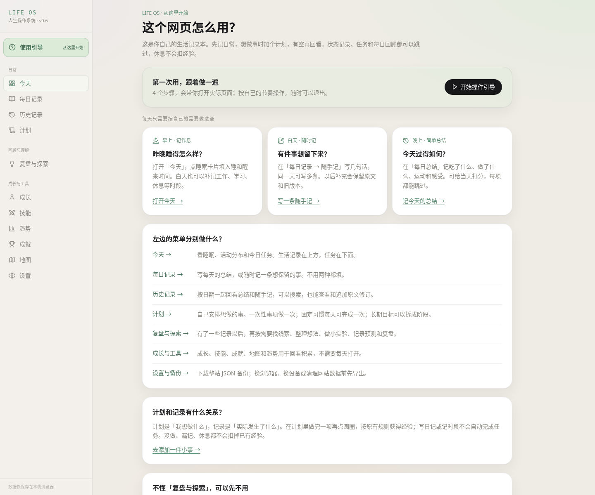
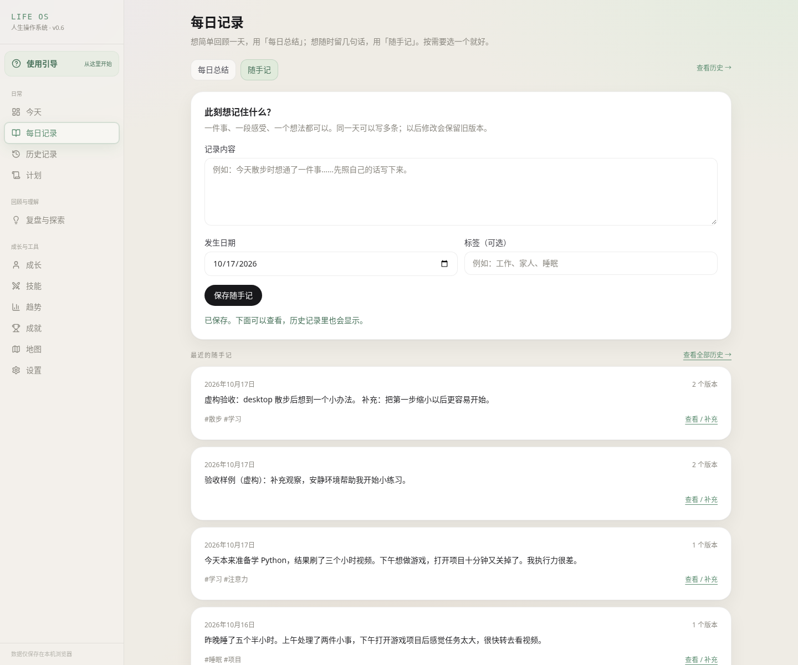
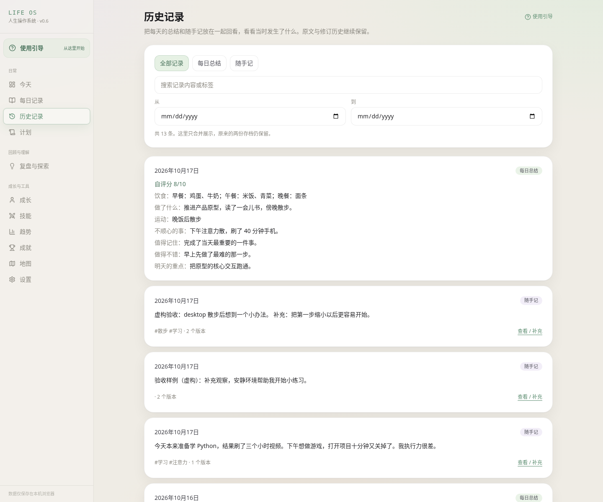
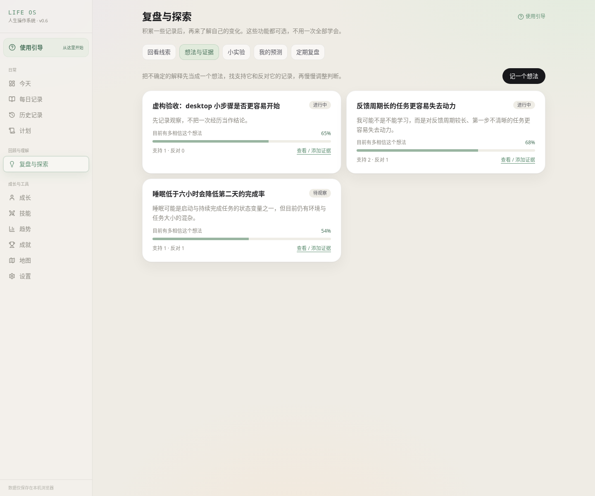
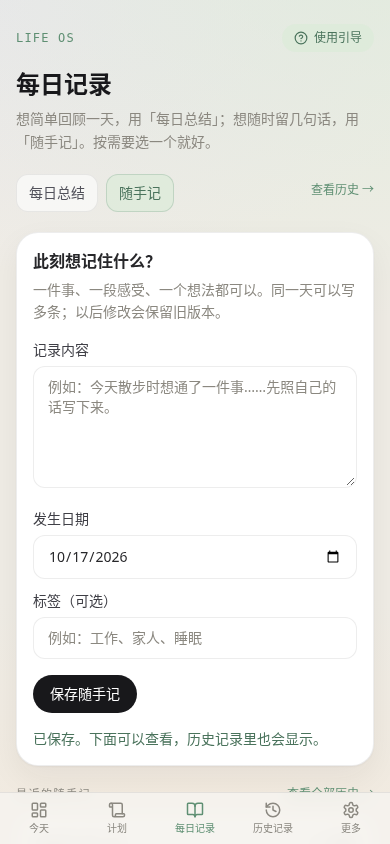
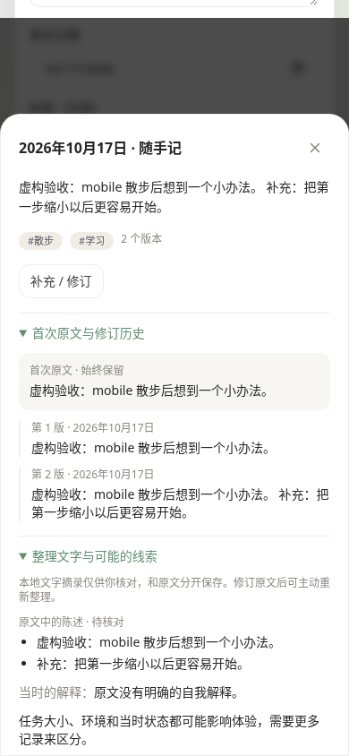
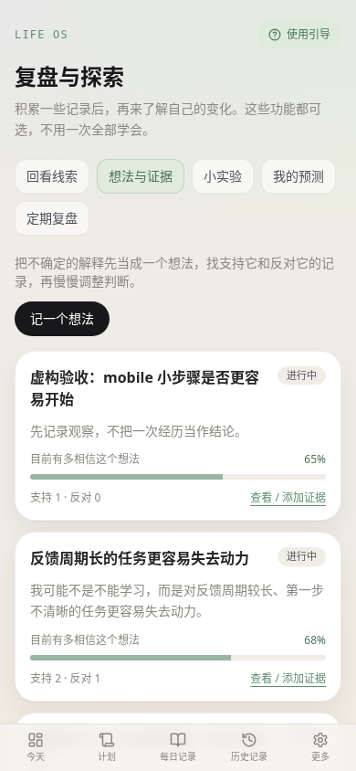
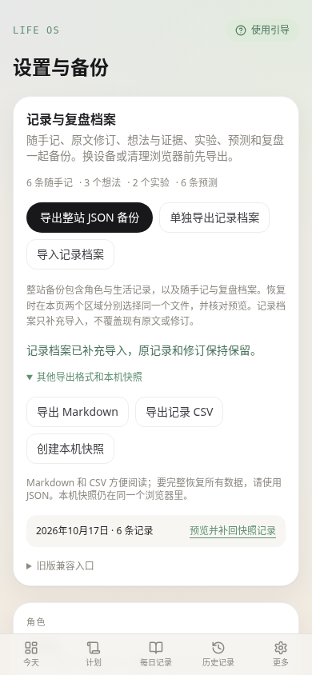

# 原生记录与复盘整合

自我历史学原来嵌在 iframe 中，产生两套菜单、颜色和滚动区域。现在将其八个功能放入 React 主应用，与生活看板共用字体、配色、卡片、表单和弹窗，使用一套主导航。

桌面侧栏第一项是「使用引导」，手机顶部和「更多」也能找到。引导页解释日常用法，并提供四步实际页面操作，不会自动创建个人记录、完成任务或修改存档。

## 功能放在哪里

新增的「失败复盘」位于「复盘与探索」第一项，「今天」有直接入口。它使用独立 localStorage，不修改下面的旧 Historian 数据模型；详见 [数据与实际截图](failure-review.md)。

| 原功能 | 当前入口 |
| --- | --- |
| TODAY / 原始记录 | 每日记录 → 随手记 |
| TIMELINE | 历史记录，与每日总结一起展示 |
| PATTERNS | 复盘与探索 → 回看线索 |
| HYPOTHESES | 复盘与探索 → 想法与证据 |
| EXPERIMENTS | 复盘与探索 → 小实验 |
| PREDICTIONS | 复盘与探索 → 我的预测 |
| REVIEWS | 复盘与探索 → 定期复盘 |
| ARCHIVE | 设置与备份 → 记录与复盘档案 |

`/#/historian` 保留为兼容路由，跳转到 `/#/journal?tab=notes`。独立 `personal-historian/` 静态页面及原有八个视图继续保留，构建时仍复制原四个静态文件。

## 日常使用

先打开使用引导；之后按需要看今天、写每日总结或随手记、安排一件小事。历史记录提供类型、日期和文字 / 标签筛选，每次先显示 50 条，可继续查看更早内容。复盘功能可以等积累一些记录以后再用。

详细步骤见 [中文使用说明](user-guide-zh.md)。本次不会改变已有 XP、技能、资本、任务或状态建议的计算规则，也不引入强制打卡或失败惩罚。

## 数据兼容与保护

- Life RPG 仍使用 `life-rpg:v1`，payload schema v3；已有每日总结、Check-in、任务、技能、资本及睡眠 / 活动时段保留。
- 随手记与复盘直接读取原 `personal-historian-db`、version 1、`workspace/current`。旧版 localStorage 备用档案仍从原 key 读取和保存，不自动迁移。
- 加载不写工作区、不自动种入演示样本、不重分析原文。未知旧字段跟随原对象保留。
- 保存前读取最新档案，在同一 IndexedDB 读写事务内追加；多原生标签页不会用旧页面状态整份覆盖新记录。焦点切换和原生标签页消息可重新读取。
- 每次原生写入都会保护已有记录 ID、首次原文和既有修订前缀。内容修改必须追加新版本；过期编辑基于旧正文提交时会拒绝保存并保留输入。
- 文字整理只有用户主动点击才执行，结果保存在独立 analysis 字段，不覆盖原文、正文或修订。小实验的整理只汇总已有数值，不写预设因果结论。
- 浏览器空间或权限不足时，不把未持久化内容显示成成功。输入仍保留；若原 IndexedDB 暂不可用，不悄悄换成空白备用档案。
- 历史记录只是合并展示，睡眠 / 完成情况只是按日期只读对齐。没有自动把日记转成活动时长，也没有把两份存档合并、删除或迁移。

旧静态页面沿用原来的整份保存方式，建议不要与原生页面同时编辑同一档案；原生页面之间已验证同时追加。兼容页面没有被重新编写。

## 备份与显式导入

- 「导出整站 JSON」包含游戏存档、完整研究档案及独立失败复盘，原文、所有修订、证据关系、相信程度历史、观察、预测结果和已有快照均在其中。恢复时三个对应区域分别预览确认，旧备份缺少失败复盘时跳过该区域。
- 可单独导出原格式 Personal Historian JSON，供旧页面使用；Markdown 和 CSV 用于阅读。
- 记录档案导入需先预览，再明确确认。相同编号且相同内容跳过；发生内容冲突时保留独立副本，并重连导入副本的证据关系，不覆盖本机原文或修订。重复导入同一档案不再新增相同副本。
- 本机快照仍在浏览器，不能替代下载备份。新快照不递归复制全部旧快照；已有快照保留。补回快照也先预览、再补充，不回滚清空当前档案。
- 角色与生活记录恢复有独立预览和确认，即使未创建角色也能恢复备份。这一步沿用整份恢复语义，可能替换该部分数据，必须先备份；随手记档案保持保留。
- 跨域、跨设备恢复必须由用户显式选择导出文件。正式版与同域 PR 预览共用浏览器存档，预览里编辑也会修改这份本机数据。

本次没有导入、迁移、清空或修改真实个人档案；所有验证使用隔离浏览器里的虚构样例。

## 验证

本次继续验收日期：2026-10-18（用户时区）。示例截图固定到虚构的 10 月 17 日以保证对比稳定。

- `pnpm install --frozen-lockfile`：通过，依赖与锁文件均未改动。
- `pnpm typecheck`、`pnpm lint`、`pnpm test`、`pnpm build`：全部通过，6 个测试文件共 37 项。覆盖原文 / 修订保护、旧存储、失败保留输入、备份去重与证据关系、原游戏功能。
- `python3 scripts/browser-smoke.py`：桌面 1440×1200、手机 390×844、窄屏 320×640；在生产构建上覆盖原生八个功能、四步引导、旧数据原样保留、刷新 / 返回 / 再进入、整站导出、去重预览导入和离线新增。
- 原有生活看板、任务、Check-in、经验、技能与资本继续验收；夏令时、本地日期切换、键盘焦点、域名根路径和 GitHub Pages 子路径继续验收。
- 旧静态页面八个视图和离线兼容 URL 继续验收；首次原生访问不自动载入演示；两原生标签页同时追加均保留原文；同域其他应用缓存不被清除。

### 实际浏览器截图

桌面使用引导与统一记录页：

桌面历史与复盘：

手机使用引导、随手记和原文修订：

手机复盘与备份：

## 已知边界与后续

- 手机验收使用 Chromium 模拟视口，尚未在 Safari / iOS 真机验证。
- 两个底层存储没有变成跨存储的单一事务；整站恢复按两部分分别预览确认，不声称两部分原子恢复。
- 旧静态页面的并发编辑能力保持原状；请避免同时在新旧页面修改同一档案。
- IndexedDB 不可用时的 localStorage 备用模式仍是单浏览器兼容方式，不提供跨标签页写事务保证。
- 本次统一界面与只读展示，没有实施大规模数据迁移。后续可继续完善每日统一记录适配器、跨时区日期归属及更细的冲突复核，须保留原文、修订和显式导入边界。
- 本云环境的网络策略可能阻止直接访问 GitHub Pages 域名；本地生产浏览器验收与 GitHub 部署结果分别报告，不将发布成功等同于已在公网浏览器复测。
