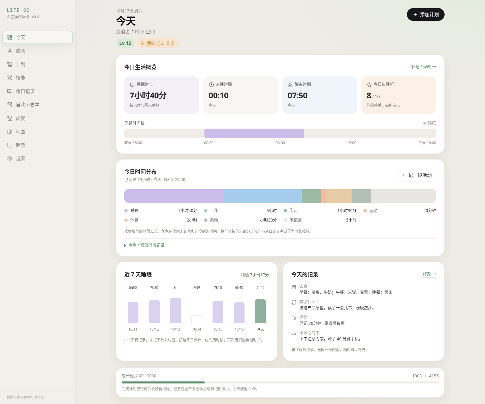
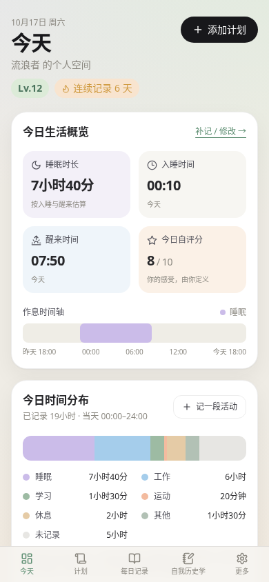
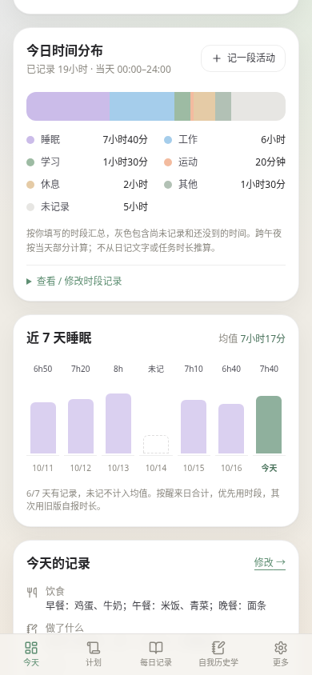
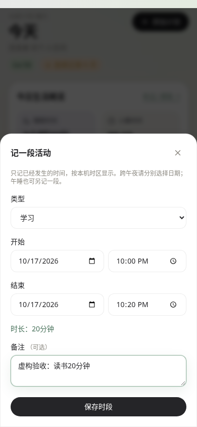
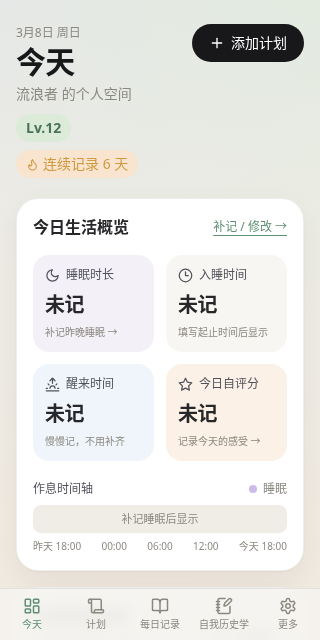

# 今天 · 生活看板

按已确认的桌面 / 手机设计，在现有 React 应用里增加生活看板。任务和成长计算规则沿用原实现，没有新增运行依赖。后续统一导航与随手记已完成，见 [原生整合与最新验收](native-research-integration.md)。

## 每天怎么用

1. 打开「今天」，最上方是四张生活卡片：睡了多久、入睡、醒来、自评分。
2. 点睡眠卡片，填写入睡和醒来的日期、时间后保存。跨午夜必须选对日期；午睡可另记一段。
3. 点「记一段活动」，选择工作、学习、运动、休息或其他，填写已经发生的起止时间。时段重叠或结束时间晚于现在时会提示修改。
4. 点「补记 / 修改」进入每日记录，填写饮食、做过的事、困难、运动和 1–10 分自评；保存后回到今天即可查看。可只填你在意的内容。
5. 首页展开「查看 / 修改时段记录」，可修改单段或确认删除。也可在「每日记录 → 时间记录 → 查看日期」回看、修改过去的时段。
6. 原有「今日任务」在生活看板和成长经验条下方。记录时段不会替你勾任务，也不产生经验奖励。

留空不视为失败，未记录的日子没有惩罚。新增时段保存失败时会保留编辑窗口和内容，明确提示没有存入浏览器；每日文字保存也有成功 / 失败提示。

## 图表怎样计算

| 内容 | 口径 |
| --- | --- |
| 睡眠时长 | 按醒来日期归属，完整入睡到醒来的估计时长；可累加多段，重叠按时间并集计算。起止卡片显示最长一段。不是设备监测的实际睡着时长。 |
| 作息时间轴 | 昨天 18:00 到今天 18:00，仅显示有明确起止的睡眠；时间窗之外不显示。 |
| 时间分布 | 按本机时区当天 00:00–24:00 裁剪后汇总；跨午夜自动拆分。分布条按类别时长排列，不是逐小时的活动时间线。 |
| 灰色部分 | 包含未记录、尚未到的时间；不会算成休息，也不从日记文字或任务预计用时推算。 |
| 7 天睡眠均值 | 按醒来日期，优先用时段，缺少时段时用旧版 Check-in 自报时长；未记排除在分母之外，明确填写的 0 小时仍有效。 |
| 旧版醒来时间 | 仍可显示和编辑，不会自动倒推入睡时间或伪造活动时长。 |
| 夏令时 | 存 ISO 时间戳，按实际经过时间统计；当天分布可能共 23 或 25 小时，界面会提示。 |
| 导入的重叠时段 | 保留原记录，重叠部分单列「重叠待核对」，不重复累计；可逐条修改。非法时间不进入图表，可在时段列表修正。 |

首页与每日记录读写同一个 `timeEntries` 集合。状态表在有睡眠时段时复用其时长，只有用户点击「保存状态」才写入 Check-in 和生成原有建议；不会仅因浏览首页而改写历史状态。之后修改时段也不会追改已保存的 Check-in、任务、结算或经验。

## 数据兼容与备份

- localStorage key 继续是 `life-rpg:v1`。payload schema 从 v2 加到 v3，只新增 `timeEntries: TimeEntry[]`。
- `TimeEntry` 包含稳定 `id`、`category`、ISO `startedAt/endedAt`、可选填写的 `note`、`createdAt/updatedAt`。手动编辑保留 id 和创建时间。
- 加载 / 导入 v1/v2 时补空集合，保留原日志、自评分、醒来时间、Check-in、任务、技能和资本；加载本身不写存储。已有用户不会自动获得示例睡眠或活动。
- JSON 导出自然包含时段；本次没有做真实数据迁移或新的批量导入合并。现有「导入恢复」仍是用户确认后的整份恢复，请先备份。未来跨系统适配、版本、去重和修订保护方案见 [v0.6 设计](life-os-v0.6-design.md)。
- 自我历史学的 IndexedDB、原文、修订及旧静态入口保留。主应用现已改用原生随手记、历史记录、复盘与探索和档案界面；`/#/historian` 兼容跳转到随手记。不同域名不能直接读取彼此存档，必须由用户显式导出 / 导入。
- GitHub Pages 正式版与同域 `/previews/pr-N/` **共用浏览器数据**，仅 service worker 与缓存按子路径隔离。预览页编辑记录也会影响同域正式版读取的存档；想单独体验可使用另一浏览器配置文件。示例模式只在用户主动选择时载入，不要用它替换已有存档。
- 所有验收与截图都在隔离浏览器中使用虚构示例，无个人日志、真实备份或 API Key。

## 本次验证

执行日期：2026-10-17。Node 24 / pnpm 11 云环境；GitHub Actions 沿用 Node 24 / pnpm 9。

- `pnpm install --frozen-lockfile`：通过，锁文件未改。云环境的 pnpm 11 使用忽略的本地配置仅允许 esbuild 构建脚本。
- `pnpm typecheck`、`pnpm lint`、`pnpm test`、`pnpm build`：全部通过，5 个测试文件共 27 项测试。
- `python3 scripts/browser-smoke.py`：生产构建上验证桌面 1440×1200、手机 390×844 和窄屏 320×640。覆盖生活看板、时段新增 / 修改 / 删除、重叠与未来时间、共享日记、返回 / 刷新 / 再进入、离线新增时段、原任务 / XP / 技能 / 资本，以及 Historian 原文修订与离线兼容入口。
- 边界包括：旧版自报睡眠 / 明确 0 / 缺失值、跨午夜和午睡、备份回读、导入冲突不重复计时、存储额度失败保留输入、键盘 Escape 关闭后恢复焦点、夏令时实际时长与本地日期切换。
- 构建继续自动复制 Historian 的 4 个静态文件，并生成含所有构建资源的离线清单。根路径与 GitHub Pages 子路径均验收。

### 实际浏览器截图

桌面首页：

手机首页与下方图表：

手机编辑时段与无记录状态：

## 已知边界与下一步

- 暂不自动分析文字、自动识别睡眠、采集设备数据或接入云同步；记录日期和展示随当前设备时区。跨时区旅行后可能改变日期归属，后续可增加记录原时区并明确显示。
- 每日总结仍是当天一份，修改不保存修订；需要多条原文及完整修订链时使用「每日记录 → 随手记」。历史记录合并展示两种文字，原始存档保持原位置。
- 首页睡眠图基于最新时段；现有「统计」页周报仍基于当时保存的 Check-in，是状态快照，两者可能不同。下一阶段可统一只读适配器，保持原始数据不变。
- 表单未保存的内容离开页面后不会保留。Safari / iOS 真机和其他浏览器尚未在本云环境实测；本次移动端验收使用 Chromium 模拟视口。
- 下一阶段先讨论每日统一记录适配器和显式导入预览、去重，再逐步实现。不得用自动分析覆盖原文或修订，也不自动迁移用户历史档案。
